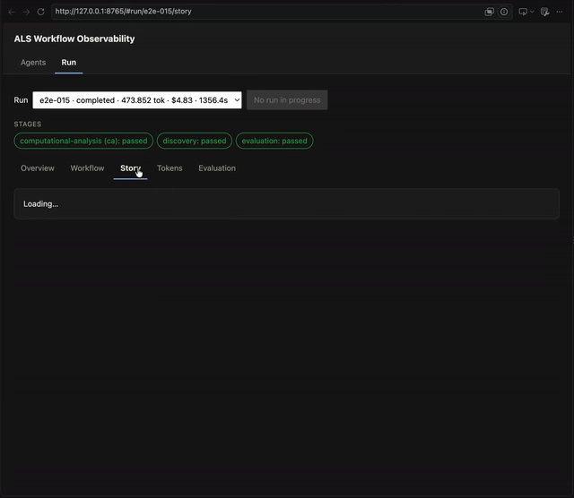

# ALS AI Scientist

[](https://github.com/gianfa/als-ai-scientist/actions/workflows/checks.yml)
[](LICENSE)
[](pyproject.toml)
[](docs/pipeline.md)
[](#als-ai-scientist)

A project developed for the International Artificial Intelligence Summer School ([IAISS 2026](https://2026.iaiss.cc/)).

A research prototype for evidence-grounded discovery of ALS/C9orf72 hypotheses. **This is not validated for scientific or clinical use and is not clinical decision support.** Outputs are research hypotheses and proposals, not performed experiments. The system may conclude that current evidence is insufficient, and that would be a valid outcome.

> [!WARNING]
> Using Opus 5.5 could get your session flagged by the server-side safety classifier (category "bio"). That is why Sonnet is the default launcher model. If you switch to Opus anyway, any fallback is recorded in `context.json`.



*The local observer UI inspecting a run: workflow design, run overview, story and evaluation (see [Web UI](#web-ui-workflow-observer)).*

## What it does

Twelve phases that move from declared inputs through computation, literature, competing hypotheses, blinded review and verification, experiment design and arbitration, an executed experiment and its reassessment, to intervention candidates and a final proposal — which may instead conclude that the evidence is insufficient.

### The pipeline as a research team

Think of a laboratory where each role is an agent, and the lab's rules are deterministic gates in code rather than instructions in a prompt. A Python host owns phase ordering, state, identifiers and every gate; the agents write only scientific content, as typed records into a knowledge base that is only ever appended to. The phases, their tools and their bounds: [docs/pipeline.md](docs/pipeline.md).

1. **No agent opens the lab.** `data` declares, resolves and hashes every input; `compute` runs four [deterministic analyses](analysis/) on those hashed paths under a fixed seed. Nothing here is a model, and a result enters the knowledge base only after its digest is recomputed independently.
2. **Literature scouts**, one per question, return atomic claims that each carry a source and a verbatim quote. The quote is checked against the stored paper before the claim is returned, so a quotation nobody can find never becomes evidence.
3. **Independent authors** each propose one hypothesis, blind to one another, as causal claims with links to the evidence and a declared statement of what they do not know. Lab rule: never only one hypothesis.
4. **Reviewers, at least two per hypothesis**, are blinded to its author and its confidence, and must bring quoted evidence that supports or contradicts.
5. **A verifier** judges, from the quoted passage alone, whether a relation holds and whether the claim says more than its quote supports. It is the host, never an agent, that records what counts as verified: nobody certifies their own work.
6. **Designers** propose experiments, each of which must declare an outcome that would contradict the claim it tests, or the schema refuses it. A deterministic check then compares what each experiment needs against what the run actually holds.
7. **An arbiter** decides what to buy, what to reject and when to stop. When a bought experiment has a registered handler, the pipeline **runs it**, re-verifies its receipt and checks the agent's reading of the result against a rule written before the result was known; a separate judgement then says what it does to the hypothesis.
8. **Intervention and the PI**: one proposes candidates with their off-target risks, stratification and biomarker; the PI writes the final proposal citing knowledge-base identifiers, and a gate checks every citation.

Nobody self-certifies: whoever generates does not verify, whoever verifies does not propose, and every final claim must resolve back to an evidence identifier, then to a stored source or a receipted computation. A run whose arbiters reject everything, or whose PI concludes `insufficient_evidence`, is a valid outcome and not a failure — three of the four completed production runs ended that way. What the [evaluation](docs/tools/evaluation.md) reports afterwards is measurement, not a score: six of its dimensions have no scorer, each for a stated reason.

## Prerequisites

- **Python 3.10+** and [uv](https://docs.astral.sh/uv/); see `pyproject.toml`
- **Claude Code** with Dynamic Workflows: https://claude.com/claude-code
  - Tested with Claude Code 2.1.282–2.1.284 (versions recorded in the `context.json` of past runs). Each new run records `claude_version` and the resolved model IDs (`resolved_models`) in its `context.json`. Other versions are untested.
- **Local scientific input**: Paper2Agent extraction of Michaelis et al. (2025) at `dist/michaelis-2025-agent/skill/michaelis-2025-paper` (not included; see [Quick start](docs/quick-start.md))
- Network access and valid Claude API credentials

## Install

A ready-made environment (Python 3.10, uv, Node 22, Claude Code, LaTeX, pandoc) is provided as a devcontainer: see [Devcontainer](docs/devcontainer.md). Manual install:

```bash
UV_PROJECT_ENVIRONMENT=.venv uv sync
```

No activation step follows: `run.sh` and the scripts under `scripts/` either call `uv run` themselves or
use nothing but the standard library, so `source .venv/bin/activate` is never required.

## First run (new user)

### The easiest route

```bash
git clone https://github.com/gianfa/als-ai-scientist
cd als-ai-scientist
scripts/setup/workspace-bootstrap.sh
```

The script walks through the steps below and skips whatever is already in place. When something can only be done by hand (downloading the article PDF) it says so and stops: do it, then run the script again. Two steps spend money: the Paper2Agent extraction (a Claude session) and the final smoke test, which asks first. It also accepts, on your behalf, the DTU academic licence the IEDB predictor is served under: read section 5 of [Data acquisition](docs/data-acquisition.md) before running it.

> [!NOTE]
> If for any reason it does not work, follow the step-by-step route below.

### Step by step

Four steps, cheapest first. Nothing before step 3 spends money, and each step tells you whether the next
one can work.

1. **Check the environment, for free.** `scripts/dev/docker-verify.sh` builds the devcontainer image and, inside
   it, runs the syntax check, `uv sync --frozen`, the Python suite, the mocked workflow suites and the report
   build. It needs Docker, no credentials and no API budget. See
   [Devcontainer](docs/devcontainer.md). **If you opened the repository in the devcontainer**, its
   `postCreate.sh` has already run `uv sync --frozen` and installed the Paper2Agent skill, so
   this step only adds the suites — useful, not required.
2. **Obtain the declared inputs, then run the two free phases.** No third-party data ships with the
   repository; `phases.data.sources` in the configuration names what a run requires, and the `data` phase
   fails explicitly when a required input is missing. The inputs and their licences are listed in
   [Quick start](docs/quick-start.md#requirements), each with its acquisition procedure in
   [Data acquisition](docs/data-acquisition.md): the article (`scripts/data/paper-download.py`, which states the
   licence and prints the PDF URL to open by hand, then the Paper2Agent command of
   [§1.1](docs/data-acquisition.md#11-extracting-it-with-paper2agent) — its `--output` path and the default
   table asset names are what the configuration addresses — checked with `scripts/setup/check-paper2agent.sh`),
   the ALS GWAS summary statistics (`scripts/data/gwas-data-download.sh`), the IEDB/NetMHCIIpan prediction cache
   (`scripts/data/iedb-cache-acquire.py`, which needs the DTU academic licence to apply to you — read section 5
   before running it) and the Zenodo cytometry deposit (`scripts/data/michaelis-data-download.sh`, declared
   `required: false`, so a run works without it). Then:

   ```bash
   ./run.sh --run-id beg-001 --phases data,compute
   ```

   `data` and `compute` use no agent and cost nothing: they resolve and hash the inputs and run the
   deterministic analyses.
3. **First paid run: the cheap configuration, on its own knowledge base.**

   ```bash
   nohup ./run.sh --run-id beg-002 --config configs/pipeline-smoke.yaml \
       --kb /tmp/kb-beg002 > experiments/beg-002-nohup.log 2>&1 & disown
   ```

   **`nohup … & disown` is the part worth not skipping.** A run is tens of minutes long and paid; started in
   the foreground it dies with the shell or the terminal, having spent money and written a partial archive.
   Re-running with the same `--run-id` resumes after the last completed phase, and
   `uv run python -m pipeline.cli stop --id beg-002` stops it.

   `--kb` on an empty directory matters from the *second* run onwards: the default knowledge base
   (`knowledgebase/`, git-ignored) is shared across runs and append-only, so a later run inherits every
   claim the earlier ones established and its archive no longer says which results are its own. On a fresh
   clone that directory is empty, so the flag changes nothing yet — it is here so the habit starts before it
   costs you a reading of your own results.
4. **Read what it produced.** [Read a result](#read-a-result) below for the files,
   [Observer UI](docs/tools/observer-ui.md) for the local web views.

## Run

```bash
./run.sh --run-id pl-008                                        # all phases, configs/pipeline.yaml
./run.sh --run-id pl-008 --config configs/pipeline-smoke.yaml   # the cheap variant
./run.sh --run-id pl-008 --phases data,compute                  # the two phases with no agent
./run.sh --help
```

A live run is paid: one `claude -p` session per phase. `run.sh` is a thin shim that forwards its
arguments to `python -m pipeline.cli`; the Python orchestrator owns phase order, state, resume,
provenance, budgets and termination ([pipeline](docs/pipeline.md)). Re-running with the same
`--run-id` resumes after the last completed phase. Results go to `experiments/<run-id>/results/`,
and the claims themselves to the shared knowledge base at `knowledgebase/`. That store is shared and
append-only: to run in isolation, pass `--kb <empty-dir>`, which starts the run from nothing and leaves
the shared store untouched.

Every limit — per-phase and whole-run spend, timeouts, web searches, claims per agent — is set in the
configuration, not in the environment; the table of what each one caps and what happens when it is
reached is in [pipeline.md](docs/pipeline.md#budgets-and-limits).

## Run with Docker

Requirements: Docker, and Claude credentials available inside the container. Setting them up is the user's responsibility: `-e ANTHROPIC_API_KEY` (as below), or a login done beforehand (`claude` inside the container, with `/home/vscode/.claude` kept in a volume). `run.sh` uses `claude -p`, which cannot prompt for a login, so a run without valid credentials stops immediately.

The image is the devcontainer image (see [Devcontainer](docs/devcontainer.md)). It contains the tools, not the repository: bind-mount the checkout. *Not yet run end to end by the author: a real run spends API budget.*

```bash
docker build -f .devcontainer/Dockerfile --build-arg UID=$(id -u) --build-arg GID=$(id -g) -t als-ai-scientist .

docker run --rm --init --pids-limit=4096 \
  --cap-drop ALL --security-opt no-new-privileges:true \
  --user "$(id -u):$(id -g)" -e HOME=/home/vscode \
  -e ANTHROPIC_API_KEY \
  -e UI_HOST=0.0.0.0 -p 127.0.0.1:8765:8765 \
  -v als-ai-scientist-claude-home:/home/vscode/.claude \
  --mount type=bind,source="$PWD",target=/app/als-ai-scientist \
  -w /app/als-ai-scientist \
  als-ai-scientist \
  bash -c '(uv sync --frozen) && ./run.sh --run-id pl-008'
```

Notes:

- The port published above is for the observer UI, which is started separately (`scripts/ops/launch-observer-ui.sh`); `run.sh` no longer starts it. It is published on `127.0.0.1` only, since the UI has no authentication.
- Resuming works from the bind mount: the orchestrator records the completed phases in `experiments/<run-id>/results/state.json`, so re-running with the same `--run-id` continues after the last one even in a fresh container. The named volume on `/home/vscode/.claude` keeps a `claude` login between containers.
- Pass arguments after `./run.sh`; the budgets are in the configuration, not in the environment.
- `--pids-limit=4096` is deliberate: the devcontainer uses 1024, and a launcher crash (exit 134) in an earlier run is not yet ruled out as a thread/process-limit abort. Each run records `logs/proc-sample.jsonl` (pids vs limit, sampled every 5 s), `sysinfo.json` (`process_limits`) and `launcher_exit.signal` in `summary.json` to settle this.
- The local Michaelis extraction (`dist/michaelis-2025-agent/...`) must exist in the checkout; see [Quick start](docs/quick-start.md).

## Web UI (workflow observer)

A local web UI, **ALS Workflow Observability**, lets you inspect the workflow without reading raw logs. **Run** shows one run, chosen in the run selector at the top (the newest is selected by default), through five views: Overview, Workflow, Story, Tokens and Evaluation. Every view reads the same selected run, and the address is linkable (`#run/<run-id>/<view>`). Full description in [docs/tools/observer-ui.md](docs/tools/observer-ui.md).

It was written for the previous architecture's runs and is started on its own (`run.sh` does not start it):

```bash
scripts/ops/launch-observer-ui.sh [--host HOST] [--port PORT]
```

The UI is served locally and is meant for inspection only; see [docs/tools/observer-ui.md](docs/tools/observer-ui.md) for the views and [README.md](README.md) for the token view and smoke-run options.

## Test

In a clean environment, start with `scripts/dev/docker-verify.sh`: it builds the devcontainer image and runs
the deterministic suites inside it (Docker required, no credentials, no API spend). Locally:

```bash
uv run pytest                                      # Python suite
node --test tests/workflow/*.test.js               # phase workflows, mocked agents
```

See [Testing guide](docs/testing.md) for full details.

## Read a result

A run that reaches synthesis writes `experiments/<RUN_ID>/results/final-proposal.md` (and `.json`): the
mechanism, the therapeutic hypothesis, the intervention, the biomarker, the proposed experiments and the
failure modes, with the citation gate's report. `state.json` lists the phases that completed, and each
`<NN>-<phase>-report.json` what that phase wrote, rejected and spent. The claims, hypotheses and their
statuses (`proposed`, `revised`, `rejected`, `surviving`) live in the knowledge base, not in the run
directory. A run may end in `insufficient_evidence`: that is a valid scientific outcome, not a failure.

To score a saved run from its archive:

```bash
uv run python -m evaluation.run_score experiments/<RUN_ID>/results --format markdown
uv run python -m evaluation.tool_usage experiments/<RUN_ID>/results --format markdown
```

The evaluation modules for the pipeline `run.sh` launches are `scorecard`, `run_score`, `citation_audit`,
`refine_entry`, `tool_usage` and `kb_stats`. See [Post-run evaluation](docs/tools/evaluation.md).

## Reproducibility

Analyses, configuration, and digests are deterministic. LLM calls and literature retrieval introduce stochasticity; "reproducible" means auditable and re-runnable with the same config and models.

## Data and Licensing

- **Michaelis et al. (Nature, 2025)**: Published CC BY-NC-ND 4.0; obtain from the [publisher](https://doi.org/10.1038/s41586-025-09588-6). The extraction is not redistributed.
- **Project code**: Apache-2.0 (see [LICENSE](LICENSE)); third-party components in [LICENSES.md](LICENSES.md).
- **External services and data** (Europe PMC, OpenAlex, Crossref, Zenodo, IEDB, MyChem.info and the catalogues it aggregates,
  such as DrugBank): read each service's current official licence and terms of use before you use it or publish what it returns.
  [LICENSES.md](LICENSES.md) records what was read and when; it is not legal advice and it can be out of date.

## Documentation

- [Quick start](docs/quick-start.md) — full setup and execution
- [Devcontainer](docs/devcontainer.md) — reproducible environment
- [Reference](docs/reference.md) — repository structure, configuration and entry points
- [Pipeline](docs/pipeline.md) — what `./run.sh` launches, phase by phase
- [Agents](docs/agents.md) — the roles of the pipeline
- [Testing guide](docs/testing.md) — test suites and CI
- [Evaluation](docs/tools/evaluation.md) — result assessment
- [Licensing](docs/licensing.md) — terms for code and inputs

## Citation

**Repository:** <https://github.com/gianfa/als-ai-scientist>

**Archive:** Zenodo, DOI [10.5281/zenodo.23370543](https://doi.org/10.5281/zenodo.23370543) (run archives pl-prod-014 to pl-prod-018, version 0.1.1)

Not validated on real scientific runs. Report issues via the repository.
