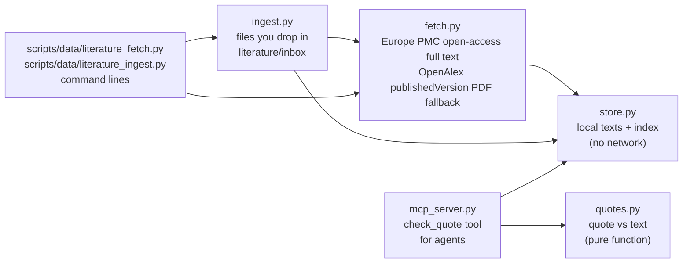
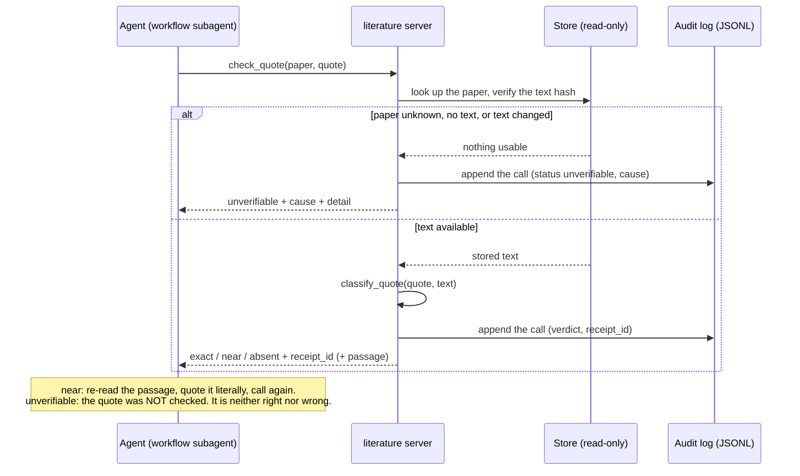

# Literature tools

How the project keeps, fetches and checks the text of scientific papers, without an LLM in the loop. This page is
for a human reader.

## Why it exists

In earlier runs, evidence was lost at verification: papers were behind paywalls, and a quote copied by an agent
did not match the source text. The fix is to give every paper a stable local copy and to check quotes against
that copy with plain code, so the verdict does not depend on another agent's opinion.

## Two packages, two jobs

| Package | Job | Contents |
|---|---|---|
| `tools/data/` | Thin, cache-first clients for external data services | `netmhciipan.py` (HLA binding predictions), `pharmacology.py` (compound name to identifiers, MyChem.info; [drug-lookup.md](drug-lookup.md)) |
| `tools/literature/` | Papers: store, fetch, ingest of your own files, quote check, MCP server | `store.py`, `fetch.py`, `ingest.py`, `quotes.py`, `mcp_server.py` |

The rest of this page is about `tools.literature`. Its modules depend on each other in one direction only:



## The store (`store.py`)

A folder of plain files, by default `literature/store/` at the repository root (git-ignored; papers are never committed). The project's `literature/` folder also holds a README and the reading lists (see `literature/README.md`).

- `index.jsonl`: append-only, one record per version of a paper (identifiers, alias, title, year, licence,
  access date, status, path and sha256 of the text, extractor used).
- `text/<id>-<hash>.txt`: the extracted text, named by content hash, so an older version stays readable.
- `INDEX.md`: a generated table for humans. Do not edit it.
- Every paper is found by any of its spellings: DOI, PMID, PMCID or its alias (for example
  `michaelis-2025-autoimmune`).
- **Integrity:** `lookup` recomputes the sha256 of the text. A text that changed on disk is treated as absent,
  never used silently.
- Status is `full_text`, `abstract_only` (too short to count as full text) or `not_available` (known paper, no
  text: the reason is recorded so it is not retried by default).

### Which store a run opens

The default root above is what the command lines and the tests use. A **run** opens the one its configuration
names, `literature_store` in `configs/pipeline*.yaml`, resolved **relative to the repository root** by
`pipeline/config.py::store_path` — not relative to your shell's working directory, and not relative to the
configuration file. So `literature/store` is the store beside this checkout, and every pipeline
configuration carries exactly that.

This is worth stating because getting it wrong is silent and has happened twice. A path that leaves the
checkout does not fail: the store creates itself wherever it is pointed, empty, and the run fetches into it
while the real one sits unused. In one production run the agents and every `check_quote` ran against 11 papers
instead of 65; in a run launched from a git worktree, against 7 instead of 68. Both times the
configured value read plausibly. If you add a configuration, the parametrised test
`test_the_configured_literature_store_is_inside_the_checkout` will refuse a path that resolves outside the
checkout or outside `literature/`.

**Running from a worktree**: a relative `literature_store` resolves inside *that* worktree's root, so a
worktree gets its own empty store unless you point it at the main checkout's — a symlink at
`<worktree>/literature/store` is enough, and the configured path has to be the relative one for the symlink
to be reached at all.

### Keeping it sound

Three read-only reports, none of which needs the network:

| Call | Answers |
|---|---|
| `LiteratureStore.summary()` | how many papers, by status, and the index's own sha256 |
| `LiteratureStore.integrity()` | per paper: readable, text not recorded, **missing** (path gone) or **mismatched** (sha256 changed), plus `sound` |
| `LiteratureStore.relink_paths(dry_run=True)` | which records hold a path that no longer resolves, and what it would be rewritten to |

`relink_paths` exists because paths were once stored absolute: 28 of 68 records held pre-flattening absolute
paths that survived every fix to the code, since they were *data*. Paths are relative now and `add` keeps
them so. Run `integrity()` after anything that moves files; `missing` and `mismatched` must both be zero.

**Repairing a store.** `scripts/ops/literature-store-relink.py` runs these reports from the command line,
for this store or any other with `--store <dir>`. It is a repair tool, not part of a run: use it when a store has
been moved or a record points at a path that no longer resolves.

```sh
uv run python scripts/ops/literature-store-relink.py --check   # integrity only; exit 1 if unsound
uv run python scripts/ops/literature-store-relink.py           # report what would be relinked
uv run python scripts/ops/literature-store-relink.py --apply   # append the corrected records
```

A record is corrected only when the file is present and hashes to the sha256 the record already declares, and
the correction is appended, never written over the existing entry.

**Merging one store into another** — after a misdirected run, say — is `add`, not `cp`: the index has to stay
consistent with the files and the digests have to be recomputed over the text actually written. `add` stamps
a fresh `access_date`, so put the original in `note` if the provenance matters. Do not carry over a
`not_available` record: it holds no text, only the finding that none is available, and `add` would store that
finding as text.

## Fetching (`fetch.py`, `scripts/data/literature_fetch.py`)

Takes a reading list (a JSON list of DOIs/PMIDs/PMCIDs) and brings the open-access papers into the store. Each
entry ends in exactly one outcome:

| Outcome | Meaning |
|---|---|
| `fetched` | downloaded, converted and stored (the only outcome that uses the cap) |
| `cached` | already in the store, nothing downloaded |
| `known_unavailable` | a previous run recorded that the text is not available |
| `paywalled` | Europe PMC knows the paper but has no open-access text, and the OpenAlex fallback (when on) found no usable `publishedVersion` PDF; recorded as `not_available` |
| `unresolvable` | not a recognisable identifier, or unknown to Europe PMC; nothing recorded |
| `skipped_over_cap` | open-access text exists but `--max-new` papers were already fetched; picked up by a later run |
| `failed` | download or parsing failed; nothing recorded |

```sh
uv run python scripts/data/literature_fetch.py --reading-list literature/reading-lists/michaelis-2025.json \
    --max-new 5 --report /tmp/fetch-report.json
```

The store defaults to `literature/store/` whatever directory you run from (`--store` overrides it). Fetching needs
network access and sends only the identifiers in your list.

**What the text contains.** Europe PMC JATS XML reduced to title, abstract and body paragraphs. Reference
markers, tables, figures and formulas are dropped, which can leave stray punctuation ("spinal cord,. Autoimmune").
A quote that spans a dropped element cannot be found. The licence is recorded as Europe PMC reports it, not
verified.

**OpenAlex fallback (`--openalex`).** For a paper Europe PMC knows but cannot serve, the OpenAlex work is looked up
by DOI (else PMID) and its PDF locations with `version: publishedVersion` are tried in order; accepted and
submitted manuscripts are never used. The first body that is really a PDF and yields text is kept under the store's
`pdf/` (git-ignored, never redistributed) and its `pdftotext` text is stored with:

- `licence`: as OpenAlex reports it for that location, possibly none (recorded as absent, not guessed);
- `text_version`: `publishedVersion`;
- `resolver`: `service: openalex`, `api_version` (the `version` OpenAlex declares at its root, `null` when it could
  not be read), the work id, the work's `updated_date` and the landing page.

A text from a PDF loses tables, captions and layout, so the quote check treats it as partial: a missing quote is
`not_found_text_may_be_incomplete`, never "not in the paper". If every location fails, the entry is `failed` with
each URL and its cause, and nothing is recorded. Calls to OpenAlex are keyless. The run pipeline
(`pipeline/provenance.py::fetch_missing`) uses the fallback by default; to retry the papers already recorded as
unavailable:

```sh
uv run python scripts/data/literature_fetch.py --reading-list LIST.json --retry-unavailable --openalex
```

## Adding your own papers (`ingest.py`, `literature/inbox/`, `literature/sources.csv`)

Papers behind a paywall cannot be fetched. Drop the file (`.pdf`, `.txt`, or JATS `.xml`) in `literature/inbox/`
(git-ignored) and, if you can, say which paper it is in `literature/sources.csv` (tracked, metadata only):

```csv
file,identifier,title,year,alias,note
michaelis-2025.pdf,10.1038/s41586-025-09588-6,Autoimmune response to C9orf72 protein in ALS,2025,michaelis-2025-autoimmune,my copy from the publisher
```

Only `file` is required in a row; `identifier` is a DOI, PMID or PMCID. Then run, from the repository root:

```sh
uv run python scripts/data/literature_ingest.py            # --offline to avoid contacting Europe PMC
```

**Where the identifier comes from.** It is the anchor of every citation: a wrong one would make a quote verify against
the wrong paper, so it is never guessed. In order:

1. **Your row in `sources.csv`** wins, and needs no network.
2. **A DOI found in the first part of the text**, accepted only if Europe PMC resolves it *and* the title Europe PMC
   gives for it occurs in that text (compared on letters and digits only, because PDF text splits words: the Michaelis PDF
   reads "C9orf 72"; titles shorter than 25 letters and digits are never enough). The record is marked as inferred and
   keeps the licence Europe PMC reports.
3. **Otherwise the file is left pending** and reported with the reason ("add a row for this file to the sources file").
   Nothing is registered, and your files are never moved, renamed or deleted.

Each file ends in one outcome: `ingested`, `already_ingested` (the same file, by sha256, is only processed once),
`pending_identifier`, `failed_extraction` (for example a scanned PDF with no text), `unsupported_type`; a row whose file is
not in the inbox is reported as `missing_file`. A changed file is a new version in the store; the old one stays in the
index.

**Agents never write the index.** The identifier and the index are the trust anchor of the quote check. A later,
optional step may let an agent *propose* an identifier for a pending file by searching online; a proposal would go to a
separate file, be checked by the same rules as point 2 (Europe PMC resolves it, the title is in the file) and be
confirmed by you. **That step is still deferred.** The agent locates, the code decides.

**Amended.** This paragraph used to add "and the index must not change during a run". It does
change now: a phase with `agent_fetch_max_new` above zero gets a second tool, `fetch_paper(identifier)`, and an agent
refused `paper_not_in_store` on a DOI, PMID or PMCID can bring that paper in and then check its quote. The sentence that
mattered is untouched — the agent passes one identifier and nothing else, `canonical_id` resolves it or the call is
refused, and `fetch_reading_list` decides what is stored, with no LLM in that path. What forced the change: of the
agents' 760 archived `check_quote` calls, 192 were refused on a paper they had correctly identified — 151 distinct
papers, of which 85 never reached a claim at all, so nothing in any archive recorded that the evidence had been found.
Two consequences to know when reading an archive: the `server_start` store snapshot is a snapshot of the stage's
*start*, and what arrived after it is in the `event: "fetch"` rows; and a paper the agent could not get is recorded
`not_available` for later runs too, exactly as the host's own fetch records it.

## Checking a quote (`quotes.py`)

`classify_quote(quote, source_text)` compares words, numbers and a few symbols (`< > = + % ±`), ignoring
punctuation and letter case, and answers one of three things:

| Verdict | Meaning | What to do |
|---|---|---|
| `exact` | the quote's words occur together, in order, in the source | the only verdict that counts as verified |
| `near` | not as written, but most of its content words sit in one stretch of the source (an elision, a dropped word) | read the returned passage and quote it literally, then check again |
| `absent` | too little overlap with any stretch, or fewer than 5 words | not found |

`critical_mismatch` is raised when a number, sign or negation of the quote is missing from that stretch. It is a
hint for the reader, not a safeguard: a negation can go unflagged if the same word appears elsewhere nearby.
### Missing quote or missing text?

A non-exact result has two very different causes: the quote is not in the paper (a paraphrase or an invention), or the
stored text lacks the passage (a table, a figure caption, a formula, a PDF layout artefact). The tool therefore also
reports `assessment`, `located_in` and `text_completeness`. Full texts from Europe PMC keep tables, captions, formulas and
the reference list apart (`extras`, `refs`) and the tool looks there too.

| `assessment` | Meaning |
|---|---|
| `found` | exact in the main text |
| `in_paper_outside_main_text` | exact in a table, caption or formula: the quote is real, but the tool does not confirm it as written |
| `not_literal` | close to a passage, not as written (paraphrase, elision, joined fragments) |
| `not_in_stored_text` | nowhere, in a text that covers the whole paper (Europe PMC JATS): not in the paper |
| `not_found_text_may_be_incomplete` | nowhere, but the stored text is known to miss parts (PDF extraction, older stores): proves nothing |

The verdict (`exact | near | absent`) is still computed on the main text only, so what counts as verified does not change.
Stores built before this change have no `extras`; re-fetch to get them.

The 0.7 threshold between `near` and `absent` was calibrated on a small sample.

## The MCP server (`mcp_server.py`)

Agents have no shell and the workflow script cannot hold the texts (the script file is limited to 512 KiB), so the
check is offered to them as a tool: `check_quote(paper, quote)` served over MCP (stdio), and — in a phase whose config
grants a budget — `fetch_paper(identifier)` beside it.

`fetch_paper(identifier)` takes a DOI, PMID or PMCID and nothing else; a title, a URL or a sentence is refused
`bad_input`, because the paper is fetched by identifier from Europe PMC and OpenAlex. Its `outcome` is
`tools.literature.fetch`'s own vocabulary (`fetched`, `cached`, `known_unavailable`, `unresolvable`, `paywalled`,
`skipped_over_cap`, `failed`) plus `bad_input`, `already_in_store` and `budget_spent`. The budget is spent only by a
paper actually stored — a refusal, a paywall or a paper already held costs nothing — and it is per phase
(`phases.<phase>.agent_fetch_max_new`, 8 for `literature` and 4 for `review`, 0 everywhere else). **Zero does not
register the tool at all**, which is the grant: a server present in a stage's MCP config is callable whatever
`--allowedTools` says, so `verify` never sees it. `lookup` re-reads the index on every call, so a paper fetched this
way is checkable by the very next `check_quote` in the same session.

`read_paper(identifier, offset)` is the fourth, and it is the only tool that gives an agent the *text* of a stored paper:
`check_quote` verifies a quotation the agent already has, it cannot be used to read. It serves the stored full text
6 000 characters at a time with the file's sha256, after `fetch_paper` has brought the paper in; a paywalled paper
comes back `not_in_store`. Its budget (`phases.<phase>.max_papers_read`, only the novelty stage declares one) counts
**different papers**, so reading a paper to the end costs what its first page costs. Zero does not register it.

`search_works(query)` is the third tool, and it finds papers by **topic** rather than by identifier: it asks OpenAlex
for the works closest to a few words and returns their identifiers, titles, years, citation counts and a shortened
abstract. It is granted the same way as `fetch_paper` — `phases.<phase>.agent_search_max`, and zero does not register
it — and today only the novelty stage declares one (8 searches for each hypothesis it launches, one grant for the whole stage: the server is shared by its agents; see [evaluation.md](evaluation.md)). The
budget is spent only by a call that reaches OpenAlex: an answer already cached costs nothing. Every answer is kept in an
append-only cache under `data/external/openalex-search-cache/` with its URL, date and OpenAlex's API version, so a
run can be re-read without the network. The list it returns is OpenAlex's relevance ranking, **not the literature**: a
work missing from it proves nothing. Calls are keyless; check OpenAlex's current terms and rate limits before relying
on them.



Rules the server follows:

- **Errors are data.** It never raises to the agent: a check it could not make comes back as
  `status: unverifiable` with a `cause` (`bad_input`, `paper_not_in_store`, `text_not_available`,
  `text_incomplete`, `text_hash_mismatch`, `service_error`) and a readable `detail`. "Could not check" is never
  confused with "checked and absent". A paper stored with only its abstract cannot prove a quote absent, hence
  `text_incomplete`.
- **No receipt, not verified.** If the server is down it cannot answer; a caller must treat that as unverified.
- **Fail closed.** If the audit line cannot be written, no verdict is given.
- **Audit.** Every call appends one JSON line (time, paper, quote, status, verdict, cause, receipt, text hash). The
  `receipt_id` is a hash of tool version, text hash, quote and verdict, so the same check gives the same receipt.
- The server refuses to start if the store folder is missing or its index is unreadable.

Start it by hand (stdout belongs to the protocol; messages go to stderr):

```sh
uv run python -m tools.literature.mcp_server --store literature/store --log /tmp/calls.jsonl
```

**Corrected 2026-10-06.** The server **is** wired into the pipeline: `pipeline/launcher.py` starts one per phase
that declares it and passes it in the session's MCP configuration, archived per run as
`results/workflows/NN-phase.mcp.json`. The paragraph that stood here said it was unwired, which was true when it
was written and has not been true since the phase pipeline was built. It can still be started by hand, as above,
for inspection.
